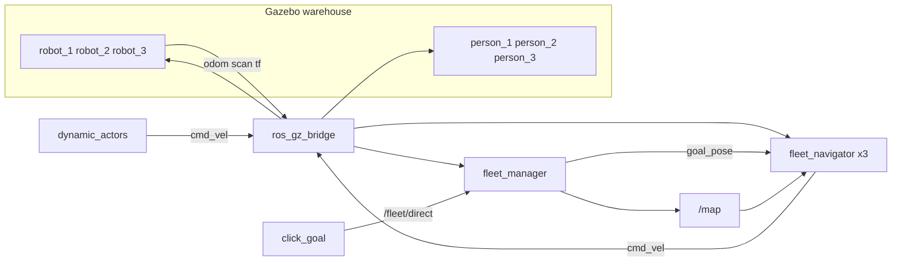

# Flotte de 3 AMR — entrepôt partagé

Trois robots différentiels partagent l’entrepôt et la carte du projet de navigation (`ros2-slam-nav2`). Chacun a son namespace (`/robot_1`, `/robot_2`, `/robot_3`), son odométrie et son TF. Une carte est publiée une seule fois. Un robot ne part que vers un but qui lui a été donné, et il contourne les autres robots comme les personnes qui marchent dans les allées.

Ce dépôt est terminé dans ce périmètre : [github.com/Maxence-Santos/ros2-fleet-nav2](https://github.com/Maxence-Santos/ros2-fleet-nav2). Ce n’est pas Nav2, ni Open-RMF, ni du multi-SLAM. Le planificateur est l’A* du projet 1, recopié ici pour que ce dépôt se construise seul.

## Lancer

ROS 2 Lyrical doit être installé dans `/opt/ros/lyrical`. `slam_toolbox` vient du workspace `ros2-slam-nav2`. `start_slam_demo.sh` source les deux.

```bash
cd ros2-fleet-nav2
./start_slam_demo.sh           # 1 robot, Gazebo + RViz, clavier
python3 save_map.py            # autre terminal : source /opt/ros/lyrical/setup.bash, slam encore lancé
./start_fleet_demo.sh          # 3 robots et 3 personnes, carte enregistrée, sans fenêtre
./start_fleet_demo.sh --gui    # Gazebo + RViz
./run_unit_tests.sh
```

La cartographie se fait avec `robot_1` seul. Les touches du terminal qui a lancé le script sont `i` avant, `k` stop, `j` gauche, `l` droite. `save_map.py` écrit `src/fleet_nav/maps/warehouse_map.yaml` et le `.pgm`. `start_fleet_demo.sh` refuse de démarrer si ces deux fichiers manquent, et la démo charge ce chemin, pas une copie de l’installation. Les personnes ne sont pas dans le monde de cartographie.

Dans RViz, prends l’outil **Publish Point**. Un clic à moins de 0,7 m d’un robot le sélectionne. Le clic suivant, ailleurs sur la carte, est la cible de ce robot. Les deux autres ne bougent pas. Sans sélection, le clic est ignoré.

Au lancement, aucun but n’est envoyé. S’il s’arrête ou reste bloqué, le but est abandonné : un autre robot ne le reprend pas. `/fleet/mission` part une fois vers le robot libre le plus proche, avec la même règle. Les affectations passent sur `/fleet/assignments`.

```bash
ros2 topic pub --once /fleet/mission geometry_msgs/msg/PoseStamped \
  "{header: {frame_id: map}, pose: {position: {x: 0.5, y: -2.5}, orientation: {w: 1.0}}}"
```

## Comportement

Trois robots : bleu en (−3,7, −3,7), orange en (0,6, −3,6), vert en (−0,2, −0,8). L’odométrie pontée est la pose vérité-terrain du modèle, déjà dans le repère du monde. `map` → `robot_N/odom` est une identité. Le DiffDrive ne publie pas sur ce topic.

Chaque navigateur charge la grille et planifie en A*. Le coût augmente près des murs, donc un passage entre une étagère et un mur est pris par le milieu. Le chemin renvoyé reste à au moins 0,25 m des obstacles et garde les coins que le quadrillage contournait. Une fois aligné, le robot suit le virage en roulant et revient sur la ligne hors évitement. S’il est dans la marge gonflée, le départ est ramené à la case libre la plus proche, jusqu’à 0,60 m.

Un mur à moins de 0,45 m coupe l’avance. Le robot pivote sur place seulement si un côté est un mur (moins de 0,50 m) et que l’autre laisse au moins 0,80 m. Dans le passage entre une étagère et le mur, les deux côtés sont plus courts : il continue sur la ligne prévue. Au départ, il tourne sur place tant que le nez est à plus de 0,30 rad du chemin et que les deux côtés laissent 0,80 m.

Un autre robot, ou une personne, n’est contourné que si le retour lidar devant lui est plus court que le mur déjà sur la carte, qu’il se rapproche à moins de 1,80 m, et qu’un côté est praticable. Une étagère, un mur qui colle à la carte, ou le coin d’une étagère dans un passage étroit ne lance pas de décalage. La parallèle est à 0,75 m, prise avant d’arriver à hauteur de l’autre. Le décalage ne grandit pas au-delà. Chacun prend sa droite quand l’autre est dans l’axe et que ce côté laisse 1,20 m : l’autre reste sur sa gauche. S’il est déjà d’un côté de la trajectoire, le décalage part de l’autre côté dès 0,55 m. Le nez tourné ne change pas ce côté. Le passage s’arrête quand l’autre a quitté l’avant et le flanc, quand le côté choisi passe sous 0,50 m, ou quand les deux côtés redeviennent le couloir de la carte. La mission n’est lâchée qu’après 4 s bloqué des deux côtés.

Si deux robots bougent et que l’un arrive sur le côté droit de l’autre, celui qui arrive s’arrête quand sa trajectoire est à droite, ou se décale à gauche pour passer derrière quand sa trajectoire est à gauche. Un robot immobile, et une personne qui ne coupe pas la ligne, gardent le décalage ordinaire. Une personne qui marche à 0,20 m/s peut déclencher le même arrêt qu’un robot mobile.

Trois personnes (cylindre de 0,25 m et tête, comme dans le projet 1) font des allers-retours : rouge à y = 1,2 m, bleu à x = −3,6 m, vert à x = 1,5 m. Elles ne sont pas sur la carte, donc le lidar les traite comme un robot.

`fleet_manager` donne `/fleet/mission` au robot `idle` le plus proche, une seule fois. Un clic passe par `/fleet/direct` et ne concerne que le robot choisi. Sans 0,30 m de progression pendant 30 s, ou après un blocage, ce but est annulé. Il n’est pas proposé à un autre robot. La carte `/map` est en QoS transient local. Les scans et l’odométrie sont lus en QoS capteur.

## Architecture



| Repère | Qui le publie |
| --- | --- |
| `map` → `robot_N/odom` | TF statique identité |
| `robot_N/odom` → `robot_N/base_link` | OdometryPublisher Gazebo, ponté vers `/tf` |
| `robot_N/base_link` → laser, roues | `robot_state_publisher`, préfixe `robot_N/` |

Le préfixe du modèle RobotModel dans RViz est `robot_1` sans slash final. RViz ajoute le slash lui-même.

## Post-mortem

**Deux odométries sur le même topic.** Le DiffDrive publie une odométrie roue qui part de zéro. Mélangée à la pose monde, elle envoyait les robots dans la mauvaise direction. Seule l’odométrie vérité-terrain est pontée. `map` → `robot_N/odom` reste une identité, et le navigateur n’ajoute pas le spawn à cette pose.

**Modèle invisible dans RViz.** Un préfixe `robot_1/` devenait `robot_1//camera_link_optical`, parce que RViz ajoute déjà un slash. Le préfixe RViz n’en a pas. `robot_state_publisher` garde le slash, et le cadre publié reste `robot_1/camera_link_optical`.

**Missions que personne n’avait données.** Après le premier trajet, un blocage réassignait le but à un autre robot, et la démo en envoyait un second au lancement. Aucun but ne part au démarrage. Un clic et `/fleet/mission` ne sont pas repris par un autre robot. Un blocage encore publié de l’ancien but ne peut pas annuler le nouveau.

**Évitements vers un mur qui n’était pas un robot.** Le lidar voyait l’étagère ou le bord de la carte et lançait un décalage. Le passage ne démarre que si le retour avant est plus court que le mur connu sur la même direction. Le rayon part du lidar et s’arrête seulement sur une cellule occupée. L’inconnu et le bord de la carte ne sont pas des murs.

**Pivot dans le passage étagère–mur.** Le côté le plus long faisait environ 0,70 m, assez pour être pris pour une sortie. Le robot tournait vers le mur et s’arrêtait. Le pivot sur place n’a lieu que si l’autre côté laisse 0,80 m. Dans ce couloir, il reste sur la ligne prévue.

**Coins rasés par le raccourci du chemin.** Tirer une corde jusqu’à la marge d’inflation coupait le coin que le quadrillage avait contourné, et le robot s’y arrêtait. Le chemin n’est simplifié que si la corde reste aussi loin des obstacles que le tronçon qu’elle remplace, et au moins à 0,25 m. Les sommets des coins sont gardés.

**Mauvais côté, puis décalage trop court.** L’angle du nez, et non celui du chemin, faisait partir le décalage vers le robot déjà sur le côté. Ensuite, une parallèle à 0,55 m n’était atteinte qu’une fois les châssis à hauteur l’un de l’autre, et le passage s’annulait parce que l’autre robot était le retour court du flanc. Le côté est choisi par rapport au chemin. La parallèle est à 0,75 m et elle est prise avant d’arriver à hauteur. Le passage n’est pas annulé tant que ce retour court est l’autre robot plutôt que la carte. En face à face, chacun garde sa droite.

**Un robot mobile qui coupe la ligne.** Celui qui le voyait à gauche se décalait à droite, le suivait, puis revenait à gauche dedans. S’il arrive sur le côté droit de l’autre et que la trajectoire reste à droite, il s’arrête jusqu’à ce que l’autre ait dégagé l’avant. S’il est déjà en décalage à gauche, ce décalage est le passage derrière et ne devient pas un arrêt.

## Chiffres

| | |
| --- | --- |
| Robots / personnes | 3 / 3 |
| Châssis | 0,30 × 0,30 m |
| Lidar | 360 points, 0,15 à 3,0 m, à 0,25 m de haut |
| Vitesse de croisière | 0,30 m/s, rotation plafonnée à 1,0 rad/s |
| Visée / waypoint / but | 0,60 m / 0,25 m / 0,30 m |
| Inflation létale | 0,35 m |
| Coût près des murs | 0,45 m, gain 6 |
| Dégagement du chemin | 0,25 m |
| Parallèle d’évitement | 0,75 m, puis 0,35 m/s |
| Avant le décalage de 0,55 m | visée à 0,40 m, 0,20 m/s |
| Face à face | droite de chacun si ce côté a 1,20 m |
| Arrêt du passage | côté choisi sous 0,50 m, ou les deux flancs de la carte sous 1,0 m |
| Blocage des deux côtés | mission lâchée après 4 s |
| Mission sans 0,30 m de progrès | annulée à 30 s, robot écarté 8 s |
| Carte enregistrée | 496 × 534 cellules, 0,02 m, origine environ (−8,35, −5,70) |
| Tests | 78 réussites sur 80. Les deux échecs sont le spawn et l’ancien but de démo de `robot_3`, hors de la zone libre de cette carte |

La zone libre connue va environ de x = −4,4 à 2,4 m et de y = −4,5 à 2,7 m. Le haut de la carte est inconnu, donc infranchissable.

## Limites

La démo à trois robots ne fait pas de SLAM. Dans un passage trop étroit pour se décaler, deux robots face à face peuvent rester bloqués : le but s’arrête là. Le spawn du robot vert et son ancien but de démo (−0,05, 1,15) tombent hors de la zone libre de la carte enregistrée. On ne remplace pas cette carte. Il faut lui donner un but dans la zone connue.

Nav2, Open-RMF, un SLAM par robot et un robot réel sont hors de ce dépôt.

## Disposition

```text
src/fleet_nav/                 paquet ament_python
  fleet_nav/                   carte, A*, poursuite, évitement, répartiteur, marcheurs
  config/                      spawns, buts, pont ros_gz
  launch/fleet.launch.py       trois robots et trois personnes
  launch/mapping.launch.py     robot_1 seul, sans personnes
  maps/                        grille enregistrée
  urdf/ worlds/
tests/                         unittest sans ROS
docs/architecture.md
docs/ROADMAP.md
```

Licence MIT. Le monde et la carte viennent du projet de navigation, même licence.
