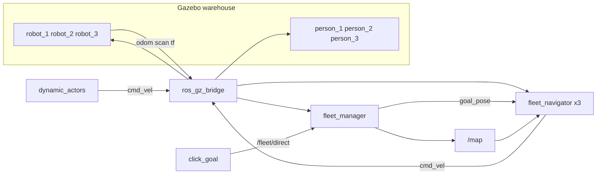

# Fleet of 3 AMRs — shared warehouse

Three differential-drive robots share the warehouse and the map from the navigation project (`ros2-slam-nav2`). Each has its own namespace (`/robot_1`, `/robot_2`, `/robot_3`), odometry, and TF. One map is published once. A robot leaves only for a goal that was given to it, and it passes other robots the same way it passes the people walking the aisles.

This repository is complete for that scope: [github.com/Maxence-Santos/ros2-fleet-nav2](https://github.com/Maxence-Santos/ros2-fleet-nav2). It is not Nav2, not Open-RMF, and not multi-SLAM. The planner is the A* from project 1, copied here so this repository builds on its own.

## Run

ROS 2 Lyrical must be installed at `/opt/ros/lyrical`. `slam_toolbox` comes from the `ros2-slam-nav2` workspace. `start_slam_demo.sh` sources both.

```bash
cd ros2-fleet-nav2
./start_slam_demo.sh           # 1 robot, Gazebo + RViz, keyboard
python3 save_map.py            # other terminal: source /opt/ros/lyrical/setup.bash, SLAM still running
./start_fleet_demo.sh          # 3 robots and 3 people, saved map, no window
./start_fleet_demo.sh --gui    # Gazebo + RViz
./run_unit_tests.sh
```

Mapping uses `robot_1` alone. In the terminal that launched the script the keys are `i` forward, `k` stop, `j` left, `l` right. `save_map.py` writes `src/fleet_nav/maps/warehouse_map.yaml` and the `.pgm`. `start_fleet_demo.sh` refuses to start if either file is missing, and the demo loads that path, not a stale copy from the install tree. People are not in the mapping world.

In RViz, use **Publish Point**. A click within 0.7 m of a robot selects it. The next click, elsewhere on the map, is that robot's goal. The other two do not move. A click with no selection is ignored.

No goal is sent at startup. If a robot stops or stays blocked, the goal is dropped: another robot does not take it. `/fleet/mission` is given once to the nearest idle robot, with the same rule. Assignments are published on `/fleet/assignments`.

```bash
ros2 topic pub --once /fleet/mission geometry_msgs/msg/PoseStamped \
  "{header: {frame_id: map}, pose: {position: {x: 0.5, y: -2.5}, orientation: {w: 1.0}}}"
```

## Behavior

Three robots: blue at (−3.7, −3.7), orange at (0.6, −3.6), green at (−0.2, −0.8). The bridged odometry is the model's ground-truth pose, already in the world frame. `map` → `robot_N/odom` is an identity. DiffDrive does not publish on that topic.

Each navigator loads the grid and plans with A*. Cost rises near walls, so a gap between a shelf and a wall is taken through the middle. The returned path stays at least 0.25 m from obstacles and keeps the corners the grid walked around. Once aligned, the robot drives the bend and returns to the line outside an avoidance. A start inside the inflated margin is snapped to the nearest free cell, up to 0.60 m.

A wall closer than 0.45 m cuts the forward speed. The robot pivots in place only when one side is a wall (under 0.50 m) and the other leaves at least 0.80 m. In the shelf-wall gap both sides are shorter, so it stays on the planned line. At departure it yaws in place while the nose is more than 0.30 rad off the path and both sides leave 0.80 m.

Another robot, or a person, is passed only when the forward lidar return is shorter than the wall already on the map, it is closing inside 1.80 m, and one side is usable. A shelf, a wall that matches the map, or a shelf corner in a narrow gap does not start an offset. The parallel is 0.75 m, taken before the robot draws level with the other. The offset does not grow past that line. Head-on, each robot takes its own right when that side leaves 1.20 m, which keeps the other on its left. If the other is already off one side of the trajectory, the offset goes to the opposite side from 0.55 m. A yawed nose does not change that side. The pass ends when the other has left the front and the flank, when the chosen side drops under 0.50 m, or when both sides are the mapped corridor again. The mission is released only after 4 s blocked on both sides.

When two robots are moving and one arrives on the right-hand side of the other, the arriving robot stops if its trajectory stays to the right, or shifts left to pass behind if its trajectory goes left. A stationary robot, and a person who does not cut the line, keep the ordinary offset. A person walking at 0.20 m/s can trigger the same stop as a moving robot.

Three people (a 0.25 m cylinder and a head, as in project 1) walk back and forth: red at y = 1.2 m, blue at x = −3.6 m, green at x = 1.5 m. They are not on the map, so the lidar treats them as a robot.

`fleet_manager` gives `/fleet/mission` to the nearest `idle` robot, once. A click goes through `/fleet/direct` and addresses only the chosen robot. With no 0.30 m of progress for 30 s, or after a block, that goal is cancelled. It is not offered to another robot. `/map` uses transient-local QoS. Scans and odometry are read with sensor QoS.

## Architecture



| Frame | Who publishes it |
| --- | --- |
| `map` → `robot_N/odom` | Static identity TF |
| `robot_N/odom` → `robot_N/base_link` | Gazebo OdometryPublisher, bridged onto `/tf` |
| `robot_N/base_link` → laser, wheels | `robot_state_publisher`, prefix `robot_N/` |

The RobotModel TF prefix in RViz is `robot_1` with no trailing slash. RViz adds the slash itself.

## Post-mortem

**Two odometries on one topic.** DiffDrive publishes wheel odometry that starts at zero. Mixed with the world pose, it sent the robots the wrong way. Only the ground-truth odometry is bridged. `map` → `robot_N/odom` stays an identity, and the navigator does not add the spawn to that pose.

**Invisible model in RViz.** A prefix `robot_1/` became `robot_1//camera_link_optical`, because RViz already adds a slash. The RViz prefix has none. `robot_state_publisher` keeps the slash, and the published frame stays `robot_1/camera_link_optical`.

**Missions nobody asked for.** After the first trip, a block handed the goal to another robot, and the demo sent a second one at startup. No goal is sent at launch. A click and `/fleet/mission` are not taken over by another robot. A block still latched from the previous goal cannot cancel the new one.

**Dodges toward a wall that was not a robot.** The lidar saw the shelf or the edge of the map and started an offset. A pass starts only when the forward return is shorter than the known wall along the same bearing. The ray starts at the lidar and stops only on an occupied cell. Unknown cells and the map border are not walls.

**Pivot in the shelf-wall gap.** The longer side was about 0.70 m, enough to look like an exit. The robot yawed into the wall and stopped. An in-place pivot happens only when the other side leaves 0.80 m. In that corridor it stays on the planned line.

**Corners shaved by the path shortcut.** Pulling a chord out to the inflation margin cut the corner the grid had walked around, and the robot stopped on it. The path is simplified only when the chord stays as far from obstacles as the span it replaces, and at least 0.25 m. Corner vertices are kept.

**Wrong side, then an offset that was too short.** The nose angle, rather than the path angle, sent the offset toward the robot already on that side. A 0.55 m parallel was then reached only once the chassis were level, and the pass was cancelled because the other robot was the short return on the trailing flank. The side is chosen against the path. The parallel is 0.75 m and it is taken before drawing level. The pass is not cancelled while that short return is the other robot rather than the map. Head-on, each robot keeps its own right.

**A moving robot that cuts the line.** The robot that saw it on the left offset right, followed it, then came back left into it. If it arrives on the other's right and the trajectory stays to the right, it stops until the other has cleared the front. If it is already offset to the left, that offset is the pass behind and does not become a stop.

## Numbers

| | |
| --- | --- |
| Robots / people | 3 / 3 |
| Chassis | 0.30 × 0.30 m |
| Lidar | 360 samples, 0.15 to 3.0 m, 0.25 m high |
| Cruise speed | 0.30 m/s, yaw capped at 1.0 rad/s |
| Lookahead / waypoint / goal | 0.60 m / 0.25 m / 0.30 m |
| Lethal inflation | 0.35 m |
| Near-wall cost | 0.45 m, gain 6 |
| Path clearance | 0.25 m |
| Pass parallel | 0.75 m, then 0.35 m/s |
| Until the offset reaches 0.55 m | aim 0.40 m ahead, 0.20 m/s |
| Head-on | each robot's own right if that side has 1.20 m |
| Pass abort | chosen side under 0.50 m, or both mapped flanks under 1.0 m |
| Blocked on both sides | mission released after 4 s |
| Mission with no 0.30 m of progress | cancelled at 30 s, robot excluded for 8 s |
| Saved map | 496 × 534 cells, 0.02 m, origin about (−8.35, −5.70) |
| Tests | 78 of 80 pass. The two failures are `robot_3`'s spawn and its old demo goal, outside the free area of this map |

Known free space runs about from x = −4.4 to 2.4 m and y = −4.5 to 2.7 m. The top of the map is unknown, so it is not traversable.

## Limits

The three-robot demo does not run SLAM. In a gap too narrow for an offset, two robots head-on can stay blocked: the goal ends there. The green robot's spawn and its old demo goal (−0.05, 1.15) fall outside the free area of the saved map. That map is not replaced. Give that robot a goal inside the known area.

Nav2, Open-RMF, one SLAM map per robot, and a physical robot are outside this repository.

## Demo video

Place a short screen capture in `media/demo.gif` or `media/demo.mp4` showing:

1. The three robots and the three walkers in Gazebo.
2. A Publish Point click on one robot, then a click on its goal in RViz.
3. That robot following the path while the other two stay put, including a pass around another robot or a walker.

Capture tips are in [`media/README.md`](media/README.md). Until the file is added, run the live demo with `./start_fleet_demo.sh --gui`.

## Layout

```text
src/fleet_nav/                 ament_python package
  fleet_nav/                   map, A*, pursuit, avoidance, dispatcher, walkers
  config/                      spawns, goals, ros_gz bridge
  launch/fleet.launch.py       three robots and three people
  launch/mapping.launch.py     robot_1 alone, no people
  maps/                        saved grid
  urdf/ worlds/
tests/                         unittest, no ROS
media/                         future demo.gif or demo.mp4
docs/architecture.md
docs/ROADMAP.md
```

MIT license. The world and the map come from the navigation project, same license.
