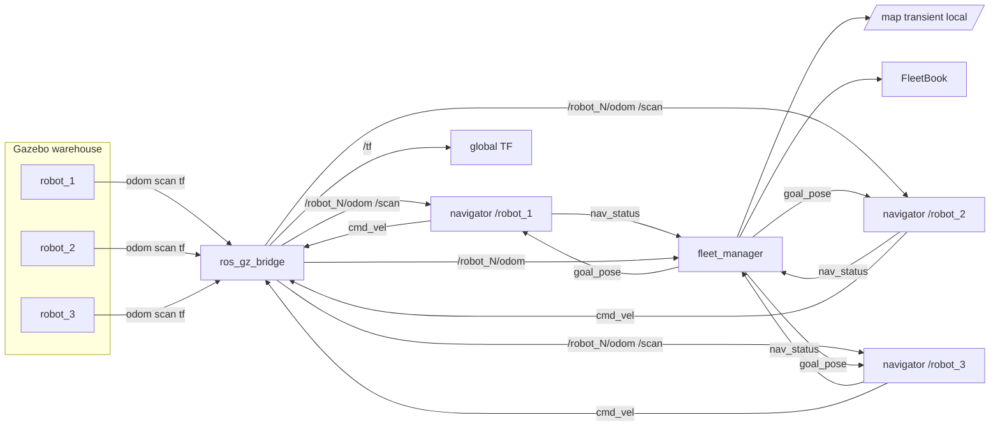

# Architecture

Three identical navigators, one map, one dispatcher. Assignment lives in `FleetBook` and does not import ROS: the tests cover it without Gazebo.

## Frames

| Frame | Who publishes it |
| --- | --- |
| `map` → `robot_N/odom` | Static identity. Ground-truth odometry is already in the world frame, aligned with `map` |
| `robot_N/odom` → `robot_N/base_link` | Gazebo `OdometryPublisher` (model pose), bridged onto `/tf` |
| `robot_N/base_link` → laser, wheels | `robot_state_publisher` with `frame_prefix` |

The Gazebo DiffDrive topic is `/model/robot_N/cmd_vel`. The bridge presents it to the navigator as `/robot_N/cmd_vel`. Odometry, scan, and joints use the same pattern.

## Assignment

`tick` is the only place a queued mission changes robot.

1. A navigating robot that has not closed 0.30 m since the last progress anchor, for 30 s, is cancelled.
2. A `blocked` status cancels as well. The robot stays excluded for 8 s.
3. The goal is dropped. It does not return to the queue, and no other robot leaves.
4. `/fleet/mission` is given once to the nearest idle robot. A click (`/fleet/direct`) addresses only the selected robot.

The distance anchor does not move on every odometry sample. It advances only when the robot has actually gained 0.30 m. Otherwise a 50 Hz odom stream would hide a stopped robot.

A goal whose `frame_id` is `cancel` stops the navigator. The dispatcher sends it when it removes the mission, so the robot does not keep driving toward the old point.

## Click in RViz

`click_goal` listens to `/clicked_point` (Publish Point). If the point is within 0.7 m of a robot, that robot becomes the selection. Otherwise the point is published on `/fleet/direct` with `frame_id` equal to the robot name. `FleetBook.command` replaces only that robot's mission.

## Map

`start_slam_demo.sh` starts `robot_1`, `slam_toolbox`, and the keyboard. `save_map.py` writes `src/fleet_nav/maps/warehouse_map.yaml` and the `.pgm`. `start_fleet_demo.sh` passes that path at launch. All three navigators plan on it. There is no SLAM during the three-robot demo.
