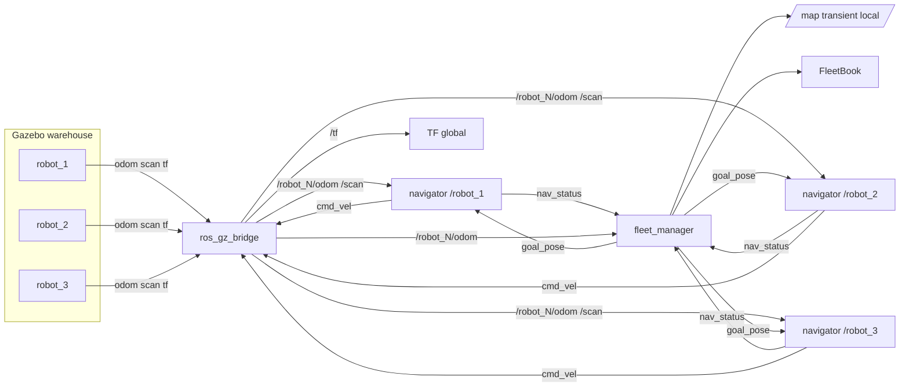

# Architecture

Trois navigateurs identiques, une carte, un répartiteur. La logique d’affectation est dans `FleetBook` et n’importe pas ROS : les tests la couvrent sans Gazebo.

## Repères

| Repère | Qui le publie |
| --- | --- |
| `map` → `robot_N/odom` | TF statique identité. L’odométrie vérité-terrain est déjà dans le repère du monde, aligné sur `map` |
| `robot_N/odom` → `robot_N/base_link` | `OdometryPublisher` Gazebo (pose du modèle), ponté vers `/tf` |
| `robot_N/base_link` → laser, roues | `robot_state_publisher` avec `frame_prefix` |

Le topic Gazebo du DiffDrive est `/model/robot_N/cmd_vel`. Le pont le présente au navigateur comme `/robot_N/cmd_vel`. Même schéma pour l’odométrie, le scan et les joints.

## Affectation

`tick` est le seul endroit où une mission change de robot.

1. Un robot qui navigue sans s’être rapproché de 0,30 m depuis la dernière ancre, pendant 30 s, est annulé.
2. Un statut `blocked` annule aussi. Le robot reste écarté 8 s.
3. Le but est abandonné. Il ne retourne pas dans la file, et aucun autre robot ne part.
4. `/fleet/mission` est donné une fois au robot libre le plus proche. Un clic (`/fleet/direct`) ne vise que le robot sélectionné.

L’ancre de distance ne bouge pas à chaque échantillon d’odométrie. Elle avance seulement quand le robot a vraiment gagné 0,30 m. Sinon un flux d’odom à 50 Hz masquerait un robot arrêté.

Un but dont `frame_id` vaut `cancel` arrête le navigateur. Le répartiteur l’envoie quand il retire la mission, pour que le robot ne continue pas vers l’ancien point.

## Clic dans RViz

`click_goal` écoute `/clicked_point` (outil Publish Point). Si le point est à moins de 0,7 m d’un robot, ce robot devient la sélection. Sinon le point part sur `/fleet/direct` avec `frame_id` égal au nom du robot. `FleetBook.command` remplace la mission de ce robot seulement.

## Carte

`start_slam_demo.sh` lance `robot_1`, `slam_toolbox` et le clavier. `save_map.py` écrit `src/fleet_nav/maps/warehouse_map.yaml` et le `.pgm`. `start_fleet_demo.sh` passe ce chemin au lancement. Les trois navigateurs planifient dessus. Il n’y a pas de SLAM pendant la démo à trois robots.
